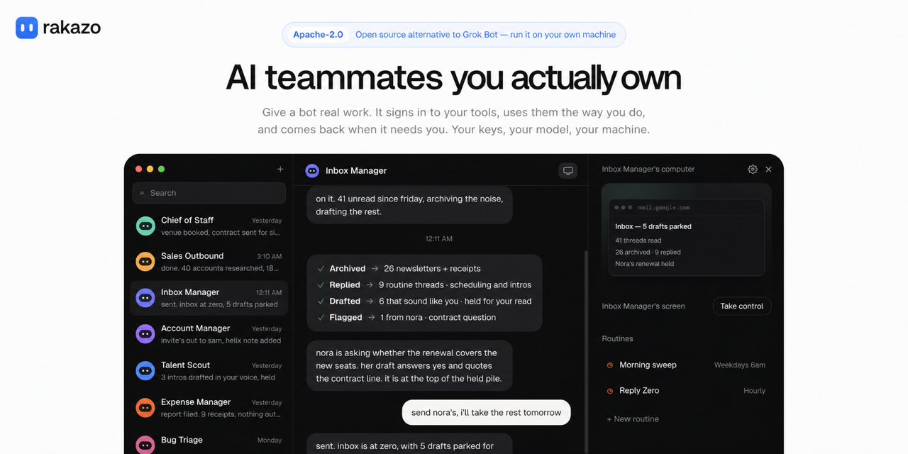

# Rakazo

[](https://github.com/elie222/rakazo/stargazers)
[](https://discord.gg/RWwKa2Sn7h)



Rakazo is an open-source platform for running persistent AI teammates. It is available on the web,
as an Electron desktop app, and through an Expo mobile app. Bring your own model and computer
provider, or run the complete stack locally.

Rakazo is in beta. Learn more at [rakazo.com](https://rakazo.com).

## Features

- **Dual-Track Inference Gateway**:
  - **Premium Track**: `gpt-oss-120b` via OpenRouter with 4-block KV prefix caching optimization.
  - **Free Track (OmniRoute Gateway v3.8.51)**: Strict-free inference with dynamic model selection by usage tags (`coding`, `writing`, `reasoning`, `fast`, `analysis`), early-flush SSE `keepalive` frame filtering, automatic resolved-provider inference (`gemini`, `mistralai`, `deepseek`, `qwen`, `meta-llama`, `nvidia`), 30s cached `/v1/models` live telemetry probe, fail-closed safety, and zero-cost guarantee (`$0.0000`).
- **Prompt Compiler (« Rendre professionnelles »)**: Two-level prompt optimization (deterministic Level 1 + OmniRoute-first LLM Level 2) with instant rollback and strict MCP immutability.
- **Unified Native Skill Library (3,538 Skills · 11 Categories) & OmniRoute AI Skill Advisor**:
  - **Zero-RAM Sharded Skill Store**: 3,538 curated procedural skills compressed into category-sharded `.json.gz` archives (`~407 KB` index + 3-shard LRU decompression) with zero frontend bundle bloat and Progressive Disclosure (`< 4 KB` direct KV-cached injection vs. `>= 4 KB` on-demand `read_skill`).
  - **Strict Per-Agent Sobriety Ceiling (`MAX_ACTIVE_SKILLS_PER_BOT = 20`)**: 0 skills enabled by default; each agent activates at most 20 tailored skills across Creation, Settings Modification, or 1-tap Live Chat Header quick-equip.
  - **2-Stage Hybrid AI Skill Advisor (`Conseiller IA de Compétences`)**: Combines bilingual FR↔EN Okapi BM25 candidate retrieval across all 3,538 skills with **OmniRoute (`$0.00` primary)** AI curation (`combo/rakazo-reasoning` / `combo/rakazo-fast`, optional OpenRouter & deterministic BM25 fallbacks), grouping selected skills by functional pole with French rationales and conversational refinement.
- **Persistent Sovereign Bots**: Bots with their own conversations, memory, routines, and history.
- **Sovereign In-Cluster MCP Adapters (19 Connectors · 96 Tools)**: First-party isolated connectors for SearXNG/Scraperr, GitHub, Notion, Postiz, WordPress/Novamira, **Windmill AutoLite RGPD**, **Windmill Proxy RGPD** (strictly non-HDS with runtime endpoint veto), Cloudflare, Twenty CRM, AFFiNE, Context7, Open Design, Image Optimizer, Qdrant, Coolify, Flowise, PocketBase, Ubersuggest (strictly ad-hoc *hors-projet*), and System Sandbox.
- **10-Probe Self-Diagnostic & Forensic Flight Recorder (`pnpm doctor` & WebUI Black Box)**:
  - **Zero-Token Active Probes (`$0.00`)**: Real-time verification of PostgreSQL/Prisma latency, stuck/failed worker runs, OmniRoute `$0` gateway combos, 3,538-skill `.json.gz` shards, Windmill AutoLite RGPD (`/api/users/whoami`), Windmill Proxy RGPD (`/api/users/whoami`), MCP HDS/Stripe security veto, V8 heap & event-loop lag, `/data` persistent storage, and client browser crashes.
  - **Automatic Flight Recorder & 1-Click AI Forensic Dossier**: Captures API 5xx errors, failed worker runs, MCP tool timeouts, blocked perimeter intrusions, and mobile/desktop React exceptions into a sanitized 150-incident ring buffer + rotating `/data/diagnostics/incidents.jsonl` with suspected `file:line` localization and 1-click `Copier le Dossier Forensique IA` Markdown export.
- **Invisible Cyber-Perimeter & Single-Owner Sanctuary (`AuthIntrusionShield`)**: Spoof-proof client IP extraction behind reverse proxies, progressive IP-only brute-force lockout (`15m` → `1h` → `6h` without locking out the owner's mobile/desktop devices), pre-hash `SIGNUP_ALLOWLIST` enforcement across both `sign-up` and `sign-in`, strict HTTPS CORS/CSRF `Origin` & `Sec-Fetch-Site` isolation, minimal unauthenticated `/health`, calibrated CSP, and 30-day sliding encrypted sessions.
- **Bounded Autonomous Subagents**: Isolated execution with Level 1 compilation, depth = 1 strict ceiling, 8,192 token budgets, and anti-loop circuit breakers.
- **Hardened Untrusted Boundaries & Cache-Aware Context (`n8n-io/nod` Innovations)**:
  - `<untrusted_tool_result>` anti-prompt-injection envelopes with closing-tag neutralization, `Europe/Paris` deterministic timestamp conversion, and Luhn/API-key/source-quote memory guards.
  - 5-minute Cold-Cache tool pruning (preserving warm KV prompt cache hits) and lossless `> 16 KB` `.rakazo/outputs/<sha256>.txt` workspace offloading.
  - Self-evolving procedural **Learned Skills** (`save` / surgical `patch`, PII scrubbing, 40-skill LRU cap, human `userEdited` lock) and quiet-by-default **Routine Delta Watches** (`verified` vs `unavailable` baseline preservation, `22:00–08:00` Quiet Hours, server-written delay banners).
  - Interactive SVG **n8n Workflow Canvas** (`N8nWorkflowCanvas`) and zero-network CSP **Sandboxed Artifact Preview** (`SandboxedArtifactModal` without `allow-same-origin`).
- **Voice Mode**: Speak replies, dictate, and call a bot (ElevenLabs, OpenAI, Cartesia).
- **Shared Team Computers & Private Sandboxes**: Browser, terminal, file, and desktop access (Docker, E2B, Daytona).
- **Full-Stack Multi-Device WebUI**: Responsive mobile-first design (320px to 1440px+), safe area support, touch-first interactions, calibrated Zinc/Emerald/Sky telemetry cockpit, and multi-chunk Rollup bundle splitting (`vendor-react`, `vendor-icons`, `vendor-markdown`, `rakazo-catalogs`) keeping every chunk under `500 kB`.

## Demo

https://github.com/user-attachments/assets/dccdeddb-2134-4a56-8eed-b2e591736b1c

## Stack

- TypeScript
- React 19, Vite, and Tailwind CSS
- Electron and Expo
- Hono and oRPC
- PostgreSQL and Prisma
- Better Auth
- Graphile Worker
- Pi
- Docker, E2B, and Daytona
- Composio

## Quick start

You need Node.js 22+, pnpm 9, and Docker Desktop.

```bash
git clone https://github.com/elie222/rakazo.git
cd rakazo
cp .env.example .env
```

Set `BETTER_AUTH_SECRET` and `ENCRYPTION_KEY` in `.env` to independent, long random values. You can
also set `OPENROUTER_API_KEY`, or connect a supported model provider during onboarding.

```bash
docker compose --env-file .env -f infra/compose/docker-compose.yml up postgres -d
pnpm install
pnpm db:generate
pnpm db:migrate
pnpm sandbox:build
pnpm dev
```

Open [http://127.0.0.1:5173](http://127.0.0.1:5173), create an account, connect a model, and create
your first bot.

For an agent-assisted installation, use [SETUP_PROMPT.md](./SETUP_PROMPT.md). For deployment,
provider selection, backups, and upgrades, see the [self-hosting guide](./docs/self-host.md).

## Desktop and mobile

The Electron and Expo apps are clients of the same Rakazo API used by the web app.

With the development stack running, launch Electron with:

```bash
pnpm --filter @rakazo/desktop dev
```

Mobile build and release instructions live in [docs/mobile-release.md](./docs/mobile-release.md).

## Development

Rakazo is a TypeScript monorepo built with React, Electron, Expo, Hono, Postgres, Prisma, Graphile
Worker, and Pi.

```text
apps/       web, api, worker, desktop, mobile, and public website
packages/   domain, contracts, persistence, adapters, UI, and test tooling
infra/      local services and computer images
docs/       architecture, operations, and release guides
```

Common checks:

```bash
pnpm doctor            # 10-probe Self-Diagnostic & AI Forensic Flight Recorder report ($0.00)
pnpm verify:sanctuary  # Full Sovereign Sanctuary & Anti-Runaway certification battery
pnpm lint
pnpm check
pnpm test
pnpm test:integration
pnpm test:e2e
```

See [CONTRIBUTING.md](./CONTRIBUTING.md) for the development workflow and test matrix.

## Documentation

```bash
pnpm test              # unit, property, and in-process contract tests
pnpm test:integration  # Postgres journeys, Graphile jobs, LISTEN/NOTIFY
pnpm test:e2e          # Playwright against the emulated stack
pnpm test:e2e -- --sandbox=e2b # the same deterministic suite against real E2B
pnpm test:e2e -- --sandbox=daytona # the same suite against real Daytona
pnpm test:e2e -- --sandbox=box # the same suite against real Box
pnpm test:topology     # local Docker + Graphile worker recovery (needs Docker)
pnpm test:canary       # live OpenRouter / E2B / Box canaries
# explicit real vision-model + real E2B desktop acceptance test:
COMPUTER_E2E_MODEL=<vision-capable-openrouter-model-id> pnpm test:computer
```

- [Testing & Anti-Runaway Certification Suite](./docs/TESTING_AND_ANTI_RUNAWAY_CERTIFICATION.md)
- [n8n-io/nod Architectural & Security Innovations](./docs/NOD_ARCHITECTURE_INNOVATIONS.md)
- [Architecture Master Blueprint](./RAKAZO_MASTER_BLUEPRINT_CURRENT.md)
- [OmniRoute Coolify & Docker Deployment Runbook](./docs/OMNIROUTE_DEPLOYMENT.md)
- [Autonomous Agent Operating Constitution (AGENTS.md)](./AGENTS.md)
- [Environment Setup & Variables Taxonomy (54+ Variables)](./docs/ENVIRONMENT_SETUP.md)
- [Self-hosting Guide](./docs/self-host.md)
- [Computer Runtime and Isolation](./docs/computer-runtime.md)
- [Mobile Releases](./docs/mobile-release.md)
- [Performance Testing](./docs/performance.md)

## Contributing

The Playwright workflow can also be started manually with **Sandbox provider** set to `e2b`, `daytona`, or `box`.
Those options require `E2B_API_KEY`, `DAYTONA_API_KEY`, or `BOX_API_KEY`, keep the deterministic scripted agent runtime, and destroy
the provider machines after the run. The default and all automatic runs remain on `fake`.
Contributions are welcome. Please read [CONTRIBUTING.md](./CONTRIBUTING.md) before opening a pull
request. For security vulnerabilities, follow [SECURITY.md](./SECURITY.md) instead of filing a public
issue.

Rakazo is licensed under the [Apache License 2.0](./LICENSE).

Questions and ideas are welcome in the [Rakazo Discord community](https://discord.gg/RWwKa2Sn7h).
