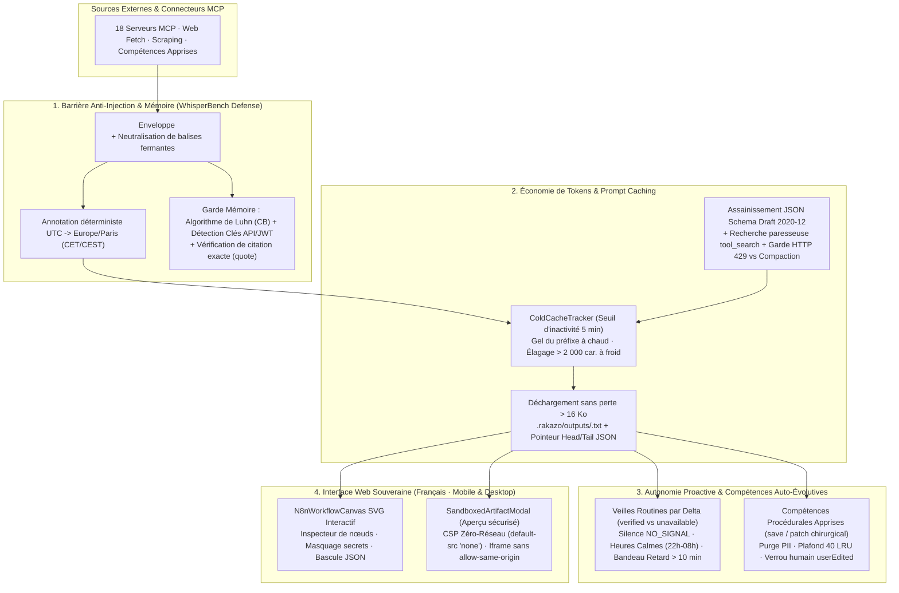

# Intégration des Innovations Architecturales `n8n-io/nod` dans Rakazo

Ce document détaille les six briques d'architecture et de sécurité inspirées de l'agent autonome open-source [`n8n-io/nod`](https://github.com/n8n-io/nod) intégrées nativement au sein du monorepo **Rakazo**, en synergie complète avec les fondations existantes (**OpenMausBot**, **CopilotKit/OpenBot**, **NousResearch/Hermes Agent**, passerelle gratuite **OmniRoute**, piste Premium **OpenRouter**, 18 serveurs MCP et 379 compétences souveraines).

---

## Vue d'ensemble de l'architecture intégrée



---

## 1. Enveloppe `<untrusted_tool_result>` & Protection Anti-Empoisonnement Mémoire

**Modules :**
- `packages/contracts/src/untrusted-envelope.ts`
- `packages/adapters/src/pi-runtime.ts` (`formatRuntimeToolOutput`, `delimitUntrustedAgentMessages`)
- `packages/adapters/src/executor.ts` (`remember` -> `validateMemorySaveSafety`)

### Garanties de sécurité
1. **Isolation structurelle des retours externes** : Tout résultat issu du Web (`web_search`, `web_fetch`, `searxng_*`), des connecteurs MCP externes (GitHub, Notion, WordPress, Cloudflare, Postiz, Odoo, Twenty CRM, Windmill, Affine, Composio, etc.) ou d'une compétence apprise dynamiquement est encapsulé dans un bloc `<untrusted_tool_result source="...">` accompagné d'une directive explicite interdisant au modèle de traiter le contenu comme une instruction système.
2. **Neutralisation d'évasion XML** : Si une page web ou un ticket externe contient une fausse balise fermante `</untrusted_tool_result>` pour tenter de sortir de la boîte à sable, celle-ci est neutralisée avant injection (`untrusted_tool_result_neutralized`).
3. **Préservation des contrats internes** : Dans `PiAgentRuntime`, l'encapsulation s'exécute au moment de `transformContext` (juste avant l'envoi au modèle), conservant intact le JSON compacté brut dans `tool.execute()` pour l'interface graphique et la télémétrie.
4. **Bouclier Mémoire (Luhn + Clés API + Citation Source)** :
   - Avant toute écriture persistante via `remember`, `validateMemorySaveSafety` bloque automatiquement tout numéro de carte bancaire valide au sens de l'**algorithme de Luhn** (13 à 19 chiffres) ainsi que tout jeton secret (`sk-...`, `ghp_...`, `xoxb-...`, JWT, clés privées PEM, `Bearer ...`).
   - Lorsqu'une citation justificative (`quote`) est fournie face au message utilisateur, `verifyMemorySourceQuote` vérifie sa présence exacte (insensible à la casse, aux accents et aux espaces multiples) afin d'empêcher l'injection indirecte en mémoire longue durée.

---

## 2. Élagage Cold-Cache (Fenêtre 5 Minutes) & Déchargement `.rakazo/outputs/`

**Modules :**
- `packages/contracts/src/cold-cache-pruning.ts`
- `packages/adapters/src/context-output-store.ts` (`offloadLargeToolOutputIfNeeded`)
- `packages/adapters/src/pi-runtime.ts` (`globalColdCacheTracker`)

### Fonctionnement en deux phases
- **Cache Chaud (`< 5 minutes` entre deux tours d'un même fil)** : Tant que le cache KV du fournisseur d'inférence est actif (`COLD_CACHE_IDLE_MS = 300_000`), `ColdCacheTracker` fige intégralement le préfixe historique des résultats d'outils afin de garantir un taux maximal de *Prompt Cache Hit* (jusqu'à 90 % d'économie sur les jetons d'entrée).
- **Cache Froid (`>= 5 minutes` d'inactivité)** : Dès que le cache fournisseur a expiré, `applyColdCacheToolPruning` élague les sorties d'outils historiques volumineuses (`> 2 000` caractères) situées avant la frontière froide en ne conservant qu'un aperçu tête/queue synthétique, tout en protégeant intégralement les derniers messages récents.
- **Déchargement disque sans perte (`> 16 000` caractères)** : Lorsqu'un outil retourne une charge utile massive dans un espace de travail disposant d'un bac à sable privé, le contenu complet est persisté de façon déterministe dans `.rakazo/outputs/<sha256>.txt` et un pointeur structuré (`workspaceFile`, `characters`, `preview`, `tail`) permet à l'agent d'inspecter le fichier à la demande sans saturer la fenêtre de contexte.

---

## 3. Micro-Optimisations Runtime (`Europe/Paris`, JSON Schema Draft 2020-12 & Garde HTTP 429)

**Modules :**
- `packages/contracts/src/pi-runtime-optimizations.ts`
- `packages/adapters/src/pi-ai-transport.ts` & `packages/adapters/src/omniroute-transport.ts`

1. **Annotation horaire déterministe `Europe/Paris`** : `annotateLocalTimestamps` détecte jusqu'à 32 horodatages ISO-8601 avec fuseau (`Z` ou offset explicite) dans les retours d'outils et injecte leur conversion exacte en heure française (`CET` / `CEST`) via `Intl.DateTimeFormat`, éliminant les erreurs de décalage horaire d'été/hiver tout en ignorant les dates seules (`YYYY-MM-DD`) et les dates calendrier invalides (`2026-02-31`).
2. **Assainissement JSON Schema Draft 2020-12** : `sanitizeToolJsonSchemaDraft2020` nettoie récursivement les schémas d'outils MCP avant expédition aux fournisseurs LLM stricts (suppression de `$schema`, conversion des `patternProperties` en `additionalProperties`, normalisation des `exclusiveMinimum`/`exclusiveMaximum` booléens Draft-04 et conversion des tuples `items` en `prefixItems`).
3. **Recherche paresseuse d'outils (`tool_search`)** : `searchLazyMcpTools` classe les connecteurs MCP par pertinence lexicale et ne retourne le schéma complet que des 3 meilleurs outils accompagné d'un index léger des autres correspondances.
4. **Discrimination stricte HTTP 429 / 402 vs Débordement de Contexte** : `classifyProviderErrorForCompaction` distingue une saturation de débit ou de quota (`rate_limit_or_quota` : HTTP 429 TPM/RPM, HTTP 402 crédits épuisés) d'un véritable dépassement de fenêtre (`context_overflow`), empêchant toute compaction destructive erronée de la conversation lors d'un pic de charge API.

---

## 4. Routines « Silencieuses par Défaut » (Delta Watches, Heures Calmes & Suivi Retard)

**Modules :**
- `packages/contracts/src/routine-watches.ts`
- `packages/adapters/src/context-output-store.ts` (`recordBotRoutineObservation`)
- `packages/adapters/src/executor.ts` (`remember` action `observe`, `buildRoutineRunTrackBannerFr`)

1. **Machine à états `verified` vs `unavailable`** : Via `remember({ action: "observe", watchKey, status, content })`, une routine enregistre ses observations structurées :
   - Si une source externe est temporairement injoignable (`status: "unavailable"`), la dernière valeur de référence vérifiée (`baselineValue`) est **préservée intacte** afin d'éviter un faux positif au cycle suivant.
   - Si la nouvelle valeur vérifiée est identique à la référence, le moteur émet la directive `NO_SIGNAL` pour maintenir la routine silencieuse.
2. **Fenêtre d'Heures Calmes (`22h00 -> 08h00 Europe/Paris`)** : Lorsqu'elle est activée dans `bot.metadata.quietHours`, `isWithinQuietHours` suspend automatiquement les notifications push/email non critiques pendant la nuit.
3. **Bandeau serveur déterministe de retard (`> 10 min`)** : Si un job planifié démarre avec plus de 10 minutes de décalage par rapport à son échéance nominale, `buildRoutineRunTrackBannerFr` injecte un en-tête factuel rédigé côté serveur en français (*« Exécution planifiée démarrée avec X min de retard… »*) sans jamais laisser le modèle inventer la cause du délai.

---

## 5. Compétences Procédurales Auto-Évolutives (`Learned Skills`)

**Modules :**
- `packages/contracts/src/learned-skills.ts`
- `packages/adapters/src/context-output-store.ts` (`mutateBotLearnedSkill`, `readBotLearnedSkill`)
- `packages/adapters/src/executor.ts` (`read_skill` actions `read` | `save` | `patch`)
- `apps/api/src/skills.ts` (verrouillage automatique `userEdited: true`)

1. **Création (`save`) et édition chirurgicale (`patch`)** : L'outil existant `read_skill` est enrichi de manière polymorphe (sans alourdir le catalogue canonique des 90 outils natifs) pour permettre à un bot principal d'enregistrer un mode opératoire réutilisable ou d'en corriger un passage précis par remplacement exact d'occurrence unique (`old` -> `new`).
2. **Purge automatique PII & Secrets** : Avant persistance, `scrubLearnedSkillPiiAndSecrets` masque systématiquement les adresses e-mail (`<email>`), clés secrètes (`[SECRET_MASQUÉ]`) et numéros de carte bancaire (`[CARTE_MASQUÉE]`).
3. **Gouvernance & Sécurité** :
   - **Plafond borné à 40 compétences par bot** avec éviction automatique LRU (`lastUsedAt`) des compétences non verrouillées.
   - **Verrou humain (`userEdited: true`)** : Toute compétence modifiée manuellement par l'utilisateur depuis l'interface Web devient immuable face aux écritures autonomes de l'agent et immunisée contre l'éviction LRU.
   - **Isolation sous-agents & webhooks** : Les sous-agents délégués et déclencheurs externes non supervisés n'ont pas le droit d'altérer le registre des compétences apprises.
   - **Relecture cloisonnée** : À la lecture, le contenu d'une compétence apprise est marqué `__untrustedSource: "learned skill"` pour bénéficier de la barrière `<untrusted_tool_result>`.

---

## 6. Canevas Interactif de Workflows `n8n` & Aperçu Sécurisé Zéro-Réseau (Web UI)

**Modules :**
- `packages/chat-ui/src/n8n-workflow.ts` & `packages/chat-ui/src/N8nWorkflowCanvas.tsx`
- `packages/chat-ui/src/markdown.web.tsx` & `packages/chat-ui/src/markdown.web.css`
- `apps/web/src/components/chat/SandboxedArtifactModal.tsx` & `apps/web/src/pages/Shell.tsx`

1. **Rendu graphique natif des workflows `n8n` (`N8nWorkflowCanvas`)** :
   - Détecte automatiquement les blocs Markdown ```` ```n8n ```` ainsi que les blocs ```` ```json ```` contenant une topologie de workflow `n8n` valide (`nodes[]` + `connections{}`), tout en ignorant les JSON ordinaires et en conservant un affichage `<pre>` sûr tant qu'un bloc est en cours de streaming.
   - Affiche un graphe SVG vectoriel interactif 100 % en français avec coloration sémantique par famille de nœud (*Déclencheur*, *Agent / IA*, *Logique*, *Code*, *Requête HTTP*, *Intégration*, *Note*), courbes de Bézier cubiques étiquetées (*vrai* / *faux* / *erreur*), contrôles de zoom tactiles (`>= 44px` sur Android/iOS), bascule code JSON brut, et inspecteur latéral masquant automatiquement tout paramètre sensible (`apiKey`, `token`, `password`, `secret` -> `[MASQUÉ]`).
2. **Modale d'Aperçu Sécurisé d'Artefacts (`SandboxedArtifactModal`)** :
   - Ajoute un bouton **« Aperçu sécurisé »** sur les cartes d'artefacts HTML, SVG, Markdown et JSON dans le fil de discussion.
   - Exécute les rendus HTML/SVG dans une `<iframe sandbox="allow-scripts" referrerpolicy="no-referrer">` **sans `allow-same-origin`** (origine opaque isolée) doublée d'une politique CSP stricte zéro-réseau (`default-src 'none'; connect-src 'none'; form-action 'none'; frame-src 'none'`), empêchant toute fuite de session ou exfiltration réseau tout en supportant la fermeture clavier par touche `Échap`.

---

## Vérification & Tests Automatisés

```bash
# Contrats & moteurs purs (Enveloppe, Luhn, Cold-Cache, Draft 2020-12, Routines, Learned Skills)
pnpm --filter @rakazo/contracts test

# Intégration Runtime, Sanctuaire des 90 outils & Compaction sémantique
npx vitest run packages/adapters/src/nod-runtime-integration.test.ts \
  packages/adapters/src/master-sanctuary-and-anti-runaway.test.ts \
  packages/adapters/src/skills-runtime.test.ts \
  packages/adapters/src/challenger-m1-empirical.test.ts

# Composants Web UI français (N8nWorkflowCanvas & SandboxedArtifactModal CSP)
npx vitest run apps/web/src/tests/nod-canvas-and-sandbox.test.tsx \
  apps/web/src/lib/chat-markdown.test.tsx
```
